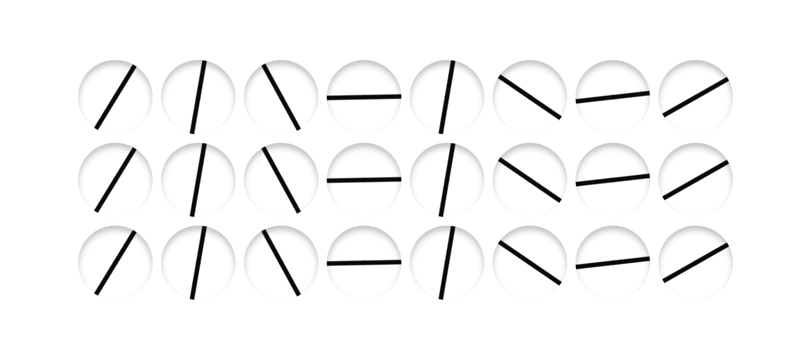
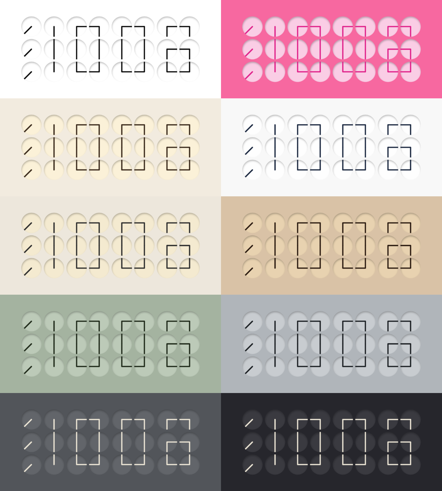
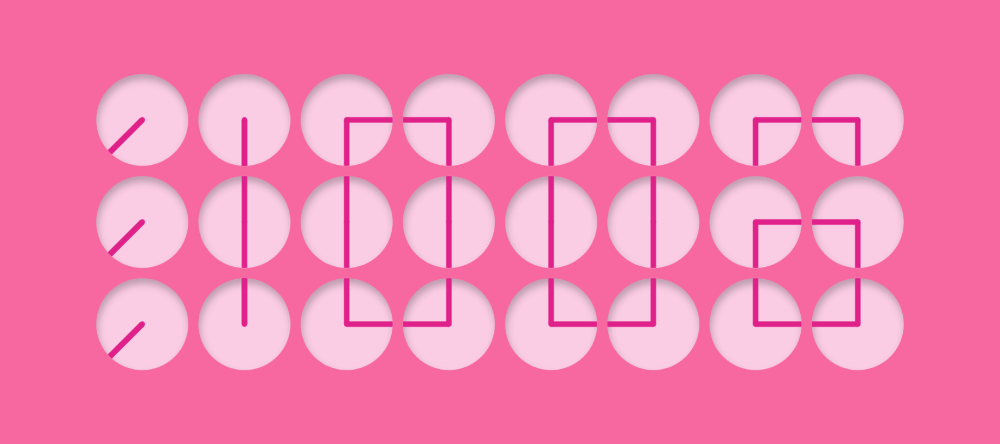
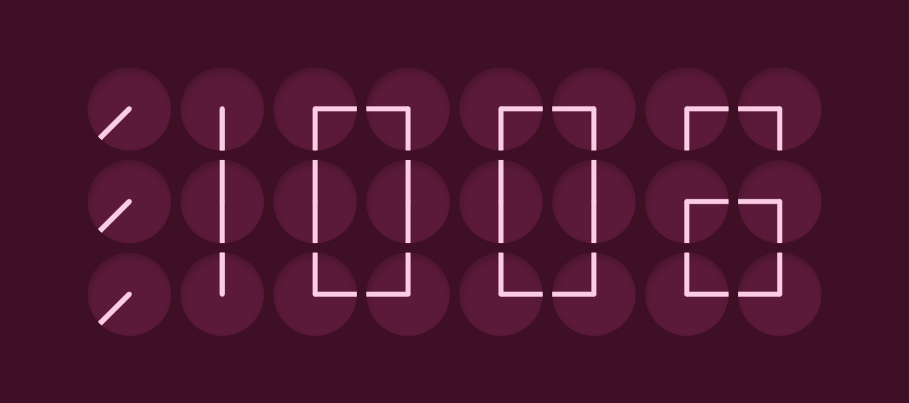

# Samay

<!-- HERO: GIF of the minute changing — Rishabh to add docs/images/hero.gif -->

Inspired by ClockClock 24 by Humans Since 1982. Not affiliated, not for sale.

Twenty-four small clocks turn their hands to spell the time. A screensaver for macOS and Windows.

Samay is Hindi for time. I wanted to live with a kinetic clock, so I made it into a screensaver.

## How it works

1. 24 dials sit in an 8 × 3 grid. Each block of 2 × 3 dials draws one digit of HH:MM.
2. Each dial has two hands. Two hands from neighbouring dials make one line, so the digits are drawn with lines that run from dial to dial.
3. When the minute changes, every hand gets a plan: when to turn, how far, which way. The screen follows that plan and the clock. Nothing is read back from the screen, so a new minute can take over cleanly, even mid-move.
4. The hands always land on the new time well inside the minute.

## What it does

- **The clock.** 24 dials spell HH:MM and re-form every minute.
- **Three ways to move.**
  - **Waves:** column by column, the dials turn into one diagonal line, spin it, then open into the time. A ripple runs left to right.
  - **Lazy:** only the dials whose digit changed move, the short way round.
  - **Fun:** every hand makes an extra full turn, the two hands of a dial in opposite directions.
- **Ten themes.** Studio, Blossom, Bone, Porcelain, Linen, Sand, Sage, Slate, Charcoal and Midnight. Each has a day and a night palette. The palette flips at 06:00 and 20:00.
- **Shadow.** Each dial has a soft inner shadow that follows the sun by day and the moon by night.
- **12 or 24 hours.**
- **macOS and Windows screensavers.** On Windows, each monitor gets its own clock.

| Blossom by day | Blossom by night |
|---|---|
|  |  |

## What's in the repo

- `mac/` — the macOS screensaver. Native Swift and Core Animation. See [mac/README.md](mac/README.md).
- `windows/` — the Windows screensaver. A small C# host with WebView2 that runs `windows/src/Resources/clock.html`. See [windows/README.md](windows/README.md).
- `web/` — `index.html`, the same clock page as a single file you can open in any browser.
- `docs/images/` — the pictures in this README.

The motion is written twice, once in JavaScript (`clock.html`) and once in Swift (`SamayView.swift`). Both use the same digit table, timings and easing.

## Try it

**In a browser.** Open `web/index.html`. Press **T** to change the theme, **M** the motion and **F** the 12/24-hour format. You can also set them in the URL: `index.html?theme=blossom&motion=fun&h24=1`.

**On a Mac.** Needs the Xcode command-line tools.

    cd mac
    ./build.sh

Then double-click `mac/build/Samay.saver` to install it, and pick Samay in System Settings → Screen Saver.

**On Windows.** Needs the .NET 8 SDK or newer. It also builds from a Mac.

    cd windows
    ./build.sh

Then right-click `windows/out/Samay.scr` and choose **Install**.

**Installers.** Ready-made installers will be on GitHub Releases. They are not signed or notarised:

- **Mac:** macOS will refuse to open the screensaver. After copying it to `~/Library/Screen Savers`, run `xattr -dr com.apple.quarantine ~/Library/Screen\ Savers/Samay.saver` once in Terminal.
- **Windows:** if SmartScreen says "Windows protected your PC", click **More info**, then **Run anyway**.

## What isn't done

- An iPhone StandBy widget. Started, not finished, not in this repo.
- The Windows version builds and passes its tests, but I haven't run it on a real Windows PC yet.

---

Shared to show the work. All rights reserved. Please ask before reusing any of it.
